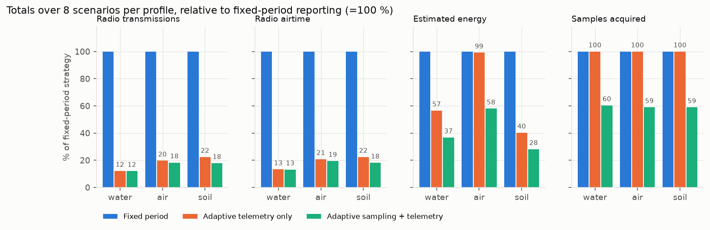

# Multipurpose Embedded Environmental Sensor Node

**Design and Development of a Multipurpose Embedded Environmental Sensor Node with Adaptive Sensing and Energy-Efficient Telemetry**

This repository holds one reusable C firmware for a **single** environmental sensor node. It is configured for **water**, **air** or **soil** monitoring by selecting an application profile. The drivers, signal processing, event detection, storage, telemetry and link layer are common to all three profiles. The node adapts both *when it samples* and *what it transmits*.

> **Software-only project.** No physical hardware was used. Sensors and the radio are virtual models behind a real HAL; the firmware runs natively (software-in-the-loop) and as a Cortex-M4 image on Renode's emulated STM32F4. All energy values are **model estimates**.



## Results (simulation, identical traces, 3 profiles × 8 scenarios)

| Profile | Strategy | TX attempts | Airtime [s] | Est. energy [J] | Critical events detected | False alarms | Mean detection delay [s] |
|---|---|---|---|---|---|---|---|
| water | fixed 60 s | 6136 | 1765.6 | 1042.6 | 4/4 | 0 | 314.8 |
| water | **adaptive** | 742 | 232.5 | 384.2 | 4/4 | 0 | 104.8 |
| air | fixed 60 s | 6142 | 1767.3 | 49695.2 | 4/4 | 0 | 309.0 |
| air | **adaptive** | 1127 | 344.1 | 28813.1 | 4/4 | 0 | 234.0 |
| soil | fixed 300 s | 5068 | 1458.3 | 559.7 | 4/4 | 0 | 1457.5 |
| soil | **adaptive** | 906 | 264.5 | 157.5 | 4/4 | 0 | 542.5 |

- **Transmissions:** −82 % to −88 %. **Estimated energy:** −42 % (air) to −72 % (soil).
- In the air profile the PM2.5 sensor (modelled with a 30 s fan warm-up at 80 mA) dominates the energy budget, so adaptive *telemetry* alone saves under 1 %; adaptive *sampling* is what helps there.
- **Costs:** slower sensor-fault detection in slow profiles, more samples during oscillating events, and a coarser picture at the gateway (raw data stays in local storage). See [docs/technical_report.md](docs/technical_report.md).
- The full tables are in [experiments/results/results_summary.md](experiments/results/results_summary.md).

## What is inside

| Area | Implementation |
|---|---|
| HAL | ADC, I2C, SPI, UART, GPIO, timer, sensor power (`firmware/include/hal.h`), backed by virtual devices |
| Drivers | pH, turbidity, moisture, NTC (ADC); EC via ADS1115-style I2C ADC; PT100 via MAX31865-style SPI; PM2.5 via PMS-style UART frame; CO2/T/RH via Sensirion-style CRC-8 words; light via BH1750-style I2C |
| Profiles | `firmware/profiles/profile_{water,air,soil}.c`: data only |
| DSP | Hampel outlier detector, moving average, 7-tap FIR (validated against MATLAB) |
| Events | NORMAL / WARNING / CRITICAL / RECOVERY / FAULT with hysteresis and confirmation |
| Adaptive sampling | STABLE / ACTIVE / ALERT / RECOVERY with profile-specific intervals |
| Telemetry | ALERT, UPDATE (changed channels only), FAULT, SUMMARY; common packet with CRC-16 |
| Link | ACK, bounded retries, exponential outage backoff with urgency cap, 128-packet priority store-and-forward queue |
| Storage | Circular log with sequence numbers (RAM, or file-backed flash emulation) |
| Energy | Charge model; RAK3172 datasheet radio currents plus documented assumptions |
| ARM | STM32F407 image (arm-none-eabi-gcc), run on Renode `stm32f4_discovery`, USART2 console |

## Build and run (Windows)

Requirements: a C compiler (MinGW-w64 gcc, or the clang/gcc bundled with OMNeT++ 6.x, which `build.bat` finds automatically), Python 3 with `numpy` and `matplotlib`, and optionally MATLAB, the Arm GNU Toolchain and Renode.

```bash
pip install -r requirements.txt
```

```bash
run.bat
```

`run.bat` builds the code, runs the C unit tests, generates the traces, runs 90 simulations, computes the metrics, makes the plots, and runs the pipeline tests. Individual steps:

```bash
build.bat
```

```bash
build\test_firmware.exe
```

```bash
build\sensor_node.exe --profile soil --strategy adaptive --trace experiments\traces\soil_gradual.csv --out out
```

```bash
build\sensor_node.exe --config experiments\configs\node.ini
```

```bash
matlab -batch "cd matlab; validate_c_output"
```

```bash
run_renode.bat
```

Other options: `--list-profiles`, `--dump-profile water`, `--seed`, `--loss`, `--ack-loss`, `--corrupt`, `--sf`, `--stable-s`, `--storage-cap`, `--node-id`. Each run writes `samples.csv`, `tx.csv`, `gateway.csv`, `storage_dump.csv` and `summary.json`.

## Repository layout

```
firmware/    include/ src/ drivers/ profiles/ hal/ targets/stm32f4/   (portable C99 core + ARM target)
simulation/  sensors/ (virtual devices + environment)  radio/ (channel + gateway)  main_sim.c
python/      generate_data.py  run_experiments.py  analyse_results.py  plots.py
matlab/      reference_filter.m  validate_c_output.m
tests/       test_firmware.c (172 checks)  test_pipeline.py (7 tests)
experiments/ configs/  results/ (CSV, markdown, plots; raw runs and traces are regenerated)
docs/        architecture, research comparison, technical report, learning guide, interview Q&A, resume bullets
```

## Verification status

| Check | Result |
|---|---|
| C unit tests | 172 passed, 0 failed |
| Python pipeline tests | 7 passed |
| MATLAB filter reference (R2026a) | max \|C − MATLAB\|: MA 5.4e-6, FIR 8.6e-7, Hampel 2.4e-7 |
| Renode STM32F4 (Renode 1.17.0) | runs to completion; samples, packets, attempts, airtime identical to native build ([log](experiments/results/renode_uart.log)) |
| Physical hardware | **not done** (no hardware available) |

## Honest limitations

These are software models only. The design has no LoRaWAN stack (airtime formula plus ACK abstraction), uses synthetic traces, and uses demonstration thresholds that are not regulatory limits. Energy uses partly assumed parameters. The three reference papers could not be read in full from the build environment (see [docs/research_comparison.md](docs/research_comparison.md)).

## Licence

MIT (see `LICENSE`). No third-party source code is included.
